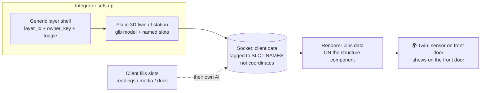

# Receiving End — what MARU prepares to receive the client socket

Condensed from `DT/MARU Client Layer Scheme — Tolerant Socket.md` (obsidian_maru_1).

## The two receiving-end pieces

1. **Generic layer shell** ("junction box"): one empty `layer_id` + `owner_key` +
   a Map Control toggle + `<ClientLayerRenderer>` mount + a card-ingest UI.
   "N sockets enabled" = pre-seeded (greyed) placeholder anchors the integrator
   lays out where data is expected. Wiring already known (context flag + panel row
   + renderer mount + ingest box) — this is the next code chunk.

2. **3D digital twin of the station** ("the wall"): NET-NEW. Current `building`
   anchor has NO 3D model behind it (resolves to a coordinate only). Needs a
   **twin registry**: `building_id` → `.glb` model + world transform + named
   sub-anchors (`front_door`, `pump_room`, `floor3_zoneB`) with local positions.
   Integrator places the model + names slots; client tags data to SLOT NAMES,
   never coordinates.

## Anchor types (extended)

| type | needs | resolves to |
|------|-------|-------------|
| `geo` | `lat`,`lon` | raw point in the world |
| `building` | `building_id`, `floor?`, `zone?` | near the structure (fallback coord today) |
| `twin_slot` | `building_id`, `slot` | a NAMED part of a 3D model (front door, pump room) — needs the twin registry |

## Who defines what
- **Integrator (us)**: generic layer shell + place the 3D twin + name the slots.
  One-time setup per client station.
- **Client (their side, via their own AI)**: fill the slots with
  `readings`/`media`/`documents`. No coordinate math, no 3D knowledge.

## Why this is the SHM-grade answer
Structural health monitoring ties sensors to structural elements. "Sensor on the
front door" must appear ON the front door, not 40 m off at the building's lat/lon.
The `twin_slot` anchor + twin registry delivers exactly that.

## Receiving-end diagram

## Build addendum (extends the forced build order)
- (0) socket schema + generic renderer — DONE (design note + `clientLayerSchema.js`
  + `ClientLayerRenderer.jsx`).
- (A) wire socket into the live map (layer shell + context flag + panel row +
  card-ingest UI) — next code chunk.
- (B) **twin registry + 3D model placement tool (integrator)** — NEW, prompted by
  user question. Net-new: no 3D model loading in MARU yet.
- (C) `twin_slot` anchor type + sub-anchor resolve in `resolveAnchor`/renderer —
  extends step (0).
- (D) tenant scoping via `owner_key` — already in schema, wired in step (A).

## Honest gap
The 3D twin part is NET-NEW. The socket schema + generic renderer already exist and
handle geo/building anchors, but MARU has NO 3D model loading yet, and no twin
registry. "Place a .glb and tag data onto its components" is a real build step
(step B/C), not something the current current code can do. The layer shell (step A)
can be built now.
